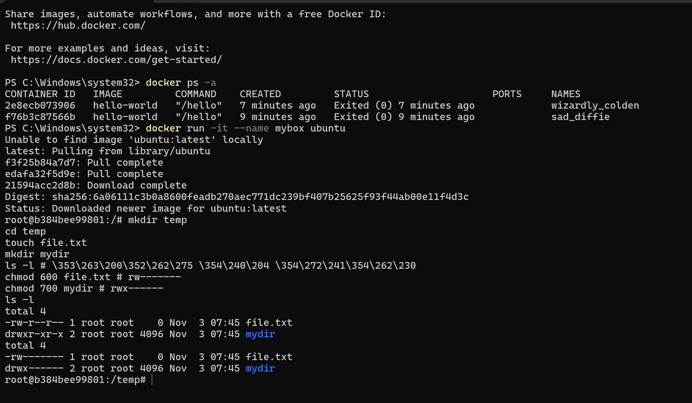
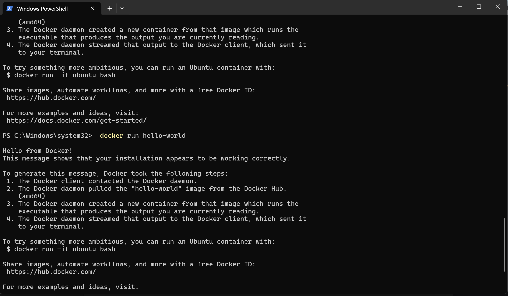
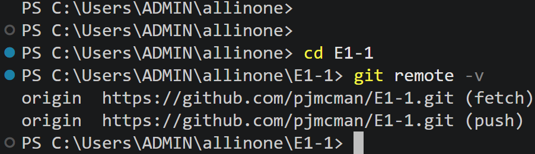
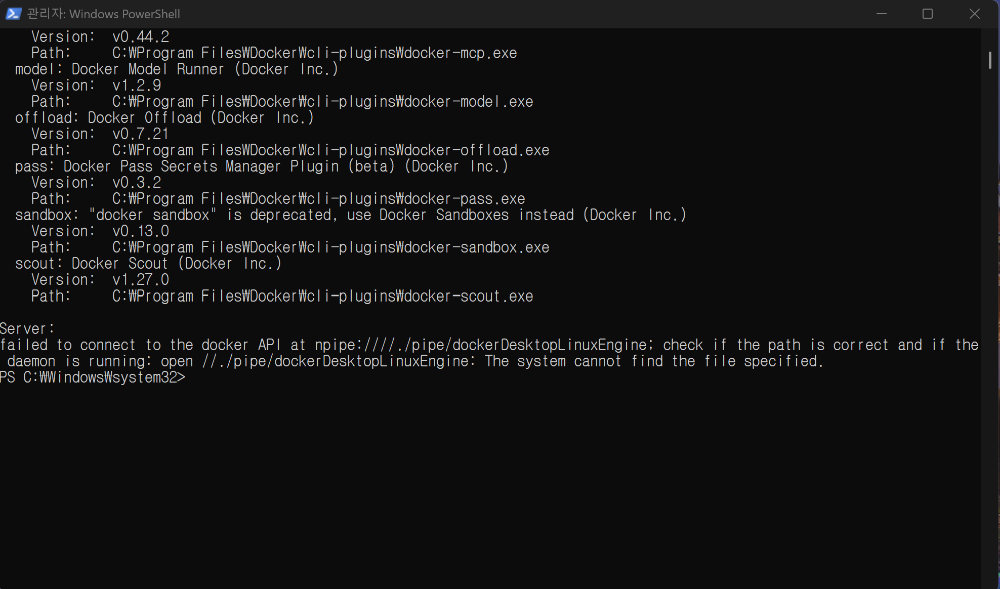
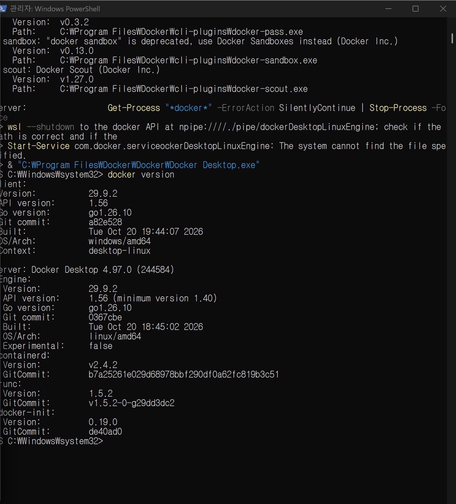
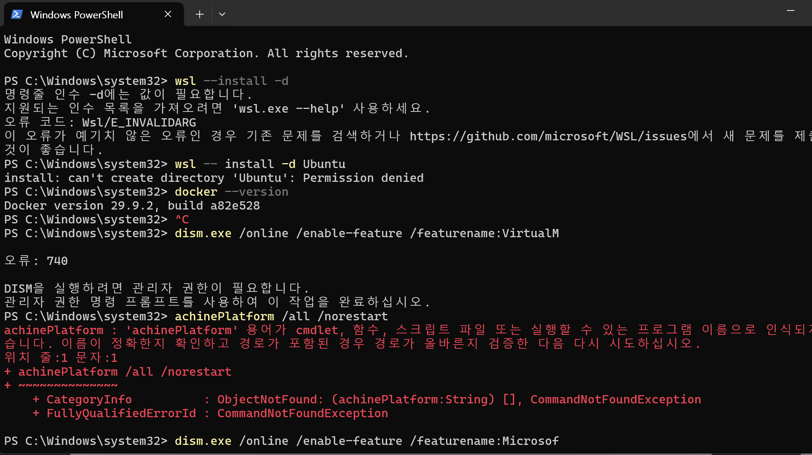
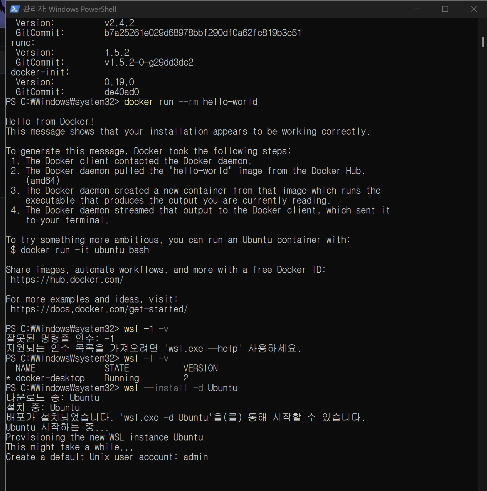
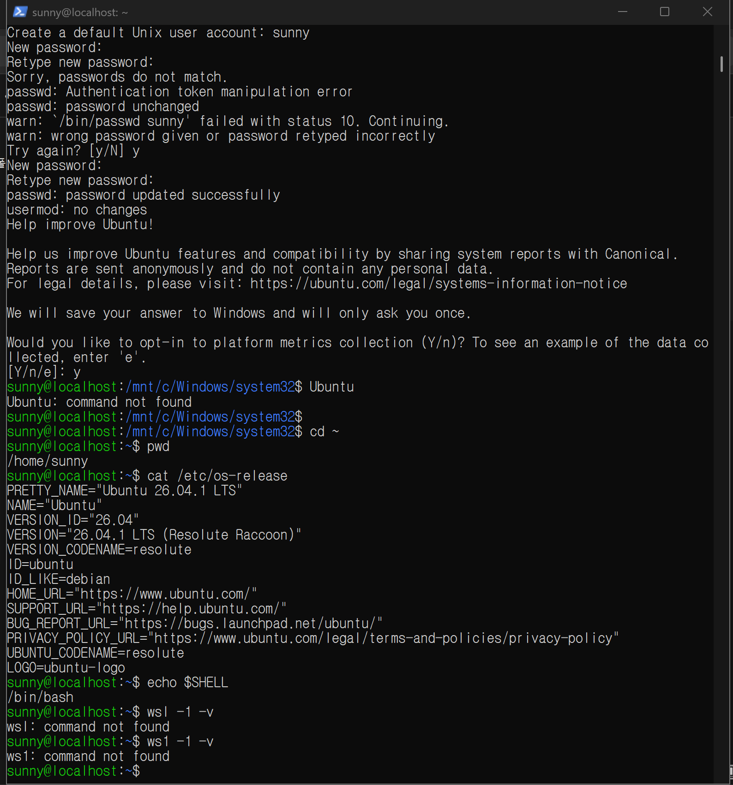
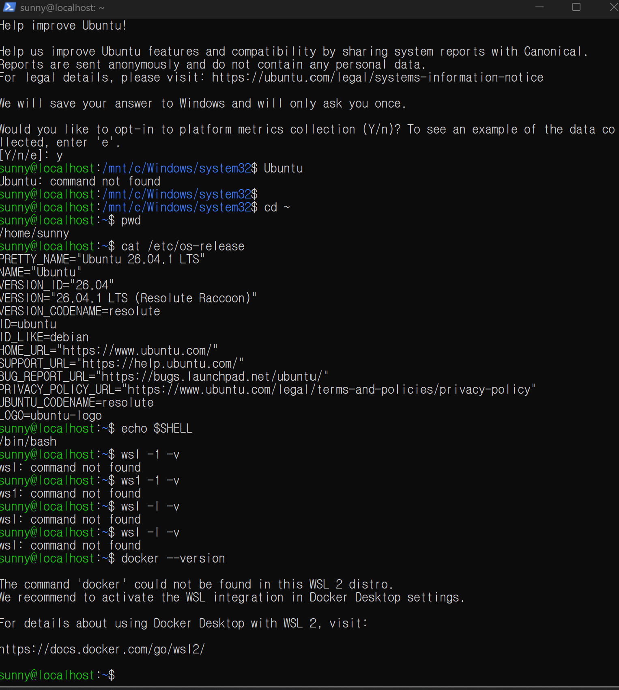

# E1-1 개발 워크스테이션 구축 (Terminal · Docker · Git)

## 1. 프로젝트 개요

터미널, Docker, Git/GitHub를 직접 세팅하고, **"내 컴퓨터에서만 되는" 문제 없이 누구나 같은 방식으로 실행할 수 있는 환경**을 만드는 미션입니다.

- 터미널로 디렉토리/파일을 조작하고 권한(r/w/x)을 실험한다.
- Docker를 점검하고, 컨테이너를 실행·중지·로그·리소스 확인한다.
- `nginx:alpine` 기반 **커스텀 이미지**를 Dockerfile로 직접 만들고, 포트 매핑으로 접속을 확인한다.
- 바인드 마운트(호스트 변경 즉시 반영)와 볼륨(컨테이너 삭제 후에도 데이터 유지)을 검증한다.
- Git 설정 후 GitHub 저장소와 연동한다.
- (보너스) Docker Compose 멀티 컨테이너 + 환경 변수 주입.

모든 명령의 **전체 출력**은 [`logs/`](logs/) 폴더에 단계별로 저장했고, 이 문서에는 핵심 부분을 발췌했습니다.

---

## 2. 실행 환경

| 항목 | 값 |
|---|---|
| OS | Windows 11 Home (10.0.26200) + WSL2 Ubuntu (권한 실습용) |
| Shell | Git Bash — GNU bash 5.3.15 |
| 터미널 | Git Bash 터미널 (VS Code 통합 터미널) |
| Docker | Docker Desktop 4.97 — Engine **29.9.2** (WSL2 backend), Compose v5.6.1 |
| Git | **2.56.0.windows.2** |

> 서울캠퍼스(macOS)는 OrbStack을 쓰지만, 이 환경은 Windows이므로 **Docker Desktop**을 사용했습니다. 둘 다 내부에서 Docker 엔진을 띄우고 `docker` CLI를 그대로 쓰므로, 아래 명령은 동일하게 재현됩니다. (Windows 고유 주의사항은 [8. 재현 방법 / 주의사항](#8-재현-방법--주의사항) 참고)

---

## 3. 수행 체크리스트

- [x] 터미널 기본 조작 (pwd / ls -la / cd / mkdir / cp / mv / rm / cat / touch) → [logs/01_terminal.txt](logs/01_terminal.txt)
- [x] 권한 변경 실습 (파일 1개 + 디렉토리 1개, 전/후 비교) → [logs/02_permission_wsl.txt](logs/02_permission_wsl.txt)
- [x] Docker 설치/점검 (`docker --version`, `docker info`) → [logs/03_docker_install.txt](logs/03_docker_install.txt)
- [x] hello-world 실행 / ubuntu 컨테이너 내부 명령 / attach vs exec → [logs/04_docker_basic.txt](logs/04_docker_basic.txt)
- [x] Docker 운영 명령 (images, ps, ps -a, stop, start, logs, stats) → [logs/04_docker_basic.txt](logs/04_docker_basic.txt)
- [x] Dockerfile 커스텀 이미지 빌드/실행 → [logs/05_dockerfile_port.txt](logs/05_dockerfile_port.txt)
- [x] 포트 매핑 접속 (8080, 8081 — 2회) → [logs/05_dockerfile_port.txt](logs/05_dockerfile_port.txt)
- [x] 바인드 마운트 변경 반영 → [logs/06_bind_mount.txt](logs/06_bind_mount.txt)
- [x] 볼륨 영속성 → [logs/07_volume.txt](logs/07_volume.txt)
- [x] Git 설정 → [logs/09_git.txt](logs/09_git.txt)
- [ ] VS Code GitHub 로그인 + 저장소 연동 (스크린샷) → [docs/screenshots/](docs/screenshots/)
- [x] (보너스) Compose 단일/멀티 컨테이너, 서비스 간 통신, up/down/ps/logs, 환경 변수 → [logs/08_compose_bonus.txt](logs/08_compose_bonus.txt)

---

## 4. 저장소 구조

```
E1-1/
├── README.md              # 이 문서
├── Dockerfile             # 커스텀 nginx 이미지
├── .dockerignore
├── docker-compose.yml     # 보너스: web + api
├── app/index.html         # 웹 서버 정적 콘텐츠
├── nginx/default.conf     # /health 엔드포인트가 추가된 nginx 설정
├── bind-site/index.html   # 바인드 마운트 실습용 (호스트에서 수정한 최종본)
├── compose/api/server.py  # 보너스: 보조 API 서비스
├── logs/                  # 단계별 명령 + 출력 전체 로그
└── docs/screenshots/      # 브라우저 / VS Code 연동 스크린샷
```

---

## 5. 수행 내용 및 검증

### 5-1. 터미널 기본 조작

| 확인 내용 | 명령 |
|---|---|
| 현재 위치 / 목록(숨김 포함) | `pwd`, `ls -la` |
| 이동 (절대/상대) | `cd practice`, `cd ..`, `cd ../practice/docs`, `cd -` |
| 생성 / 빈 파일 | `mkdir -p`, `touch empty.txt` |
| 내용 기록 / 확인 | `echo ... > note.txt`, `cat note.txt` |
| 복사 / 이름변경 / 이동 | `cp`, `mv empty.txt renamed.txt`, `mv renamed.txt docs/` |
| 삭제 | `rm`, `rm -r` |

```bash
$ pwd
/c/Users/ADMIN/allinone/E1-1

$ mkdir -p practice/docs
$ cd practice && pwd
/c/Users/ADMIN/allinone/E1-1/practice

$ touch empty.txt
$ echo "hello codyssey" > note.txt
$ cat note.txt
hello codyssey

$ ls -la
total 5
drwxr-xr-x 1 ADMIN 197121  0 Nov  8 22:29 .
drwxr-xr-x 1 ADMIN 197121  0 Nov  8 22:29 ..
drwxr-xr-x 1 ADMIN 197121  0 Nov  8 22:29 docs
-rw-r--r-- 1 ADMIN 197121  0 Nov  8 22:29 empty.txt
-rw-r--r-- 1 ADMIN 197121 15 Nov  8 22:29 note.txt

$ cp note.txt docs/note_copy.txt
$ mv empty.txt renamed.txt
$ mv renamed.txt docs/
$ ls -la docs
-rw-r--r-- 1 ADMIN 197121 15 Nov  8 22:29 note_copy.txt
-rw-r--r-- 1 ADMIN 197121  0 Nov  8 22:29 renamed.txt

$ cd ../practice/docs && pwd && cd -
/c/Users/ADMIN/allinone/E1-1/practice/docs
/c/Users/ADMIN/allinone/E1-1/practice

$ rm docs/renamed.txt
$ rm -r docs
$ ls -la
-rw-r--r-- 1 ADMIN 197121 15 Nov  8 22:29 note.txt
```

**절대 경로 vs 상대 경로**
- 절대 경로: 루트(`/`)부터 시작하는 전체 경로. 현재 위치와 무관하게 항상 같은 곳을 가리킴. 예) `/c/Users/ADMIN/allinone/E1-1/practice`
- 상대 경로: **현재 위치 기준** 경로. `.`은 현재, `..`은 상위 디렉토리. 예) `practice/docs`에서 `cd ..` → `practice`, `../practice/docs` → 상위로 올라갔다가 다시 docs로.
- 스크립트·설정에서 절대 경로는 "내 PC 경로"에 종속되기 쉬우므로, 저장소 안에서는 상대 경로를 쓰는 편이 재현성에 유리합니다.

### 5-2. 권한 실습

Git Bash(Windows NTFS)에서는 `chmod`가 반영되지 않아([트러블슈팅 #2](#트러블슈팅-2-git-bash에서-chmod가-적용되지-않음)), **실제 리눅스 파일시스템인 WSL Ubuntu**에서 수행했습니다.

```bash
$ touch script.sh && mkdir shared
$ ls -l                                   # 변경 전
-rw-r--r-- 1 sunny sunny    0 Nov  8 22:29 script.sh
drwxr-xr-x 2 sunny sunny 4096 Nov  8 22:29 shared

$ chmod 755 script.sh                     # 파일: rwx r-x r-x
$ chmod 700 shared                        # 디렉토리: 소유자만 접근
$ ls -l                                   # 변경 후
-rwxr-xr-x 1 sunny sunny    0 Nov  8 22:29 script.sh
drwx------ 2 sunny sunny 4096 Nov  8 22:29 shared

$ stat -c "%A %a %n" script.sh shared
-rwxr-xr-x 755 script.sh
drwx------ 700 shared

$ chmod u=rw,g=r,o=r script.sh && chmod g+rx,o+rx shared   # 기호 방식
$ stat -c "%A %a %n" script.sh shared
-rw-r--r-- 644 script.sh
drwxr-xr-x 755 shared

$ echo "echo hi" > script.sh && chmod 000 script.sh && cat script.sh
cat: script.sh: Permission denied          # r 없음 → 읽기 불가

$ chmod 644 script.sh && ./script.sh
./script.sh: Permission denied             # x 없음 → 실행 불가

$ chmod 755 script.sh && ./script.sh
hi
```

**권한 해석 규칙**
- `rwx` 3자리 묶음이 **소유자(u) / 그룹(g) / 기타(o)** 순으로 3번 반복.
- 숫자 표기: `r=4`, `w=2`, `x=1`을 더한 값. 각 자리 = 한 그룹.
  - `755` = `7(4+2+1) 5(4+1) 5(4+1)` = `rwxr-xr-x` → 소유자만 수정, 모두 읽기/실행 (실행 파일·디렉토리 기본)
  - `644` = `6(4+2) 4 4` = `rw-r--r--` → 소유자만 수정, 모두 읽기 (일반 파일 기본)
  - `700` = `rwx------` → 소유자 전용
- 디렉토리에서의 의미: `r` = 목록 보기, `w` = 안에 파일 생성/삭제, `x` = 진입(cd)·내부 접근.

**보충 증거: ubuntu 컨테이너 안에서 같은 실험 (캡처)**

`file.txt`가 `644 → 600`(`-rw-r--r--` → `-rw-------`)으로, `mydir`가 `755 → 700`(`drwxr-xr-x` → `drwx------`)으로 바뀌었습니다. 컨테이너 안도 리눅스 파일시스템이라 chmod가 정상 반영됩니다.



### 5-3. Docker 설치 및 점검

```bash
$ docker --version
Docker version 29.9.2, build a82e528

$ docker info        # (발췌 — 전체는 logs/03_docker_install.txt)
Client:
 Version:    29.9.2
 Context:    desktop-linux
Server:
 Containers: 6
 Images: 6
 Server Version: 29.9.2
 Storage Driver: overlayfs
 Cgroup Version: 2
 Kernel Version: 6.18.54.1-microsoft-standard-WSL2
 Operating System: Docker Desktop
 OSType: linux
 Architecture: x86_64
 CPUs: 16
 Total Memory: 15.28GiB
```

`Server:` 섹션이 출력되면 데몬이 동작 중이라는 뜻입니다. (데몬이 꺼져 있을 때의 실패 → [트러블슈팅 #1](#트러블슈팅-1-docker-데몬-연결-실패))

### 5-4. 컨테이너 실행 실습 + 운영 명령

```bash
$ docker pull hello-world
$ docker pull ubuntu:24.04
$ docker images
IMAGE                    ID             DISK USAGE   CONTENT SIZE   EXTRA
hello-world:latest       c567b231f656       25.9kB         9.49kB   U
ubuntu:24.04             fe81560990fa        119MB         31.7MB
...

$ docker run --name e1-hello hello-world
Hello from Docker!
This message shows that your installation appears to be working correctly.
...

$ docker run --rm ubuntu:24.04 bash -c "ls /; echo hello-from-ubuntu; cat /etc/os-release | head -2"
bin
boot
dev
etc
home
...
hello-from-ubuntu
PRETTY_NAME="Ubuntu 24.04.5 LTS"
NAME="Ubuntu"
```

**캡처: PowerShell에서 hello-world 실행**



**캡처: `docker run -it`로 ubuntu 컨테이너에 대화형으로 들어가 명령 실행**

`docker ps -a`로 이전 hello-world 컨테이너를 확인하고, `docker run -it --name mybox ubuntu`로 들어갔습니다. 프롬프트가 `root@b384bee99801:/#`(컨테이너 ID)로 바뀐 것이 내부에 진입했다는 증거입니다. 그 안에서 `mkdir`, `touch`, `ls -l`, `chmod`를 실행했습니다.


**exec vs attach 관찰**

```bash
# exec: 실행 중인 컨테이너에 "새 프로세스"를 추가로 띄움
$ docker run -d --name e1-ubuntu ubuntu:24.04 sleep infinity
$ docker exec e1-ubuntu bash -c "echo inside-exec && ls /tmp && hostname"
inside-exec
94d8d1d2e167

# attach: 컨테이너의 "메인 프로세스(PID 1)" 표준입출력에 직접 연결
$ docker run -di --name e1-attach ubuntu:24.04 bash
$ echo "echo from-attach; exit" | docker attach e1-attach
$ docker logs e1-attach
from-attach

$ docker ps -a --filter name=e1-
CONTAINER ID   IMAGE          COMMAND            STATUS                     NAMES
b041213cb0a9   ubuntu:24.04   "bash"             Exited (0) ...             e1-attach   ← exit 하자 컨테이너도 종료
94d8d1d2e167   ubuntu:24.04   "sleep infinity"   Up 3 seconds               e1-ubuntu   ← exec 끝나도 계속 실행
334bc01b0c8a   hello-world    "/hello"           Exited (0) ...             e1-hello
```

| | `docker exec` | `docker attach` |
|---|---|---|
| 연결 대상 | 새로 띄운 별도 프로세스 | 메인 프로세스(PID 1) |
| 빠져나올 때 `exit` | 그 프로세스만 종료, **컨테이너 유지** | 메인 프로세스 종료 → **컨테이너 종료** |
| 용도 | 디버깅·점검 (운영 중 안전) | 메인 프로세스 출력을 직접 볼 때 (`Ctrl+P, Ctrl+Q`로 분리해야 유지) |

**중지/재시작/로그/리소스**

```bash
$ docker stop e1-ubuntu
$ docker ps -a --filter name=e1-
94d8d1d2e167   ubuntu:24.04   "sleep infinity"   Exited (137) 1 second ago   e1-ubuntu
$ docker start e1-ubuntu
$ docker logs e1-hello
Hello from Docker!
...
$ docker stats --no-stream e1-ubuntu
CONTAINER ID   NAME        CPU %     MEM USAGE / LIMIT     MEM %     NET I/O       BLOCK I/O   PIDS
94d8d1d2e167   e1-ubuntu   0.00%     1.367MiB / 15.28GiB   0.01%     952B / 126B   0B / 0B     1
```

### 5-5. Dockerfile 기반 커스텀 이미지 (방식 A)

**선택한 베이스:** 공식 `nginx:1.27-alpine` 이미지 (작은 용량의 검증된 웹 서버). 버전 태그를 고정해 언제 빌드해도 같은 결과가 나오도록 했습니다.

```dockerfile
FROM nginx:1.27-alpine
LABEL org.opencontainers.image.title="e1-1-custom-nginx" \
      org.opencontainers.image.description="Codyssey E1-1 dev workstation mission web server"
ENV APP_ENV=dev
COPY nginx/default.conf /etc/nginx/conf.d/default.conf
COPY app/ /usr/share/nginx/html/
HEALTHCHECK --interval=10s --timeout=3s --retries=3 \
  CMD wget -qO- http://127.0.0.1/health || exit 1
EXPOSE 80
```

| 커스텀 포인트 | 목적 |
|---|---|
| `LABEL` | 이미지 이름/설명 메타데이터 → `docker inspect`로 출처 확인, 관리 용이 |
| `ENV APP_ENV=dev` | 실행 환경 구분값을 코드 밖에서 주입 (설정과 코드 분리) |
| `COPY nginx/default.conf` | `/health` 헬스체크 전용 엔드포인트 추가 |
| `COPY app/` | 기본 Welcome 페이지를 직접 만든 정적 페이지로 교체 |
| `HEALTHCHECK` | 프로세스가 "떠 있는지"가 아니라 "응답하는지"를 Docker가 주기적으로 검사 → `docker ps`에 `(healthy)` 표시 |
| `.dockerignore` | logs/docs 등 불필요한 파일을 빌드 컨텍스트에서 제외 |

```bash
$ docker build -t e1-web:1.0 .
#5 [1/3] FROM docker.io/library/nginx:1.27-alpine@sha256:6564...
#6 [2/3] COPY nginx/default.conf /etc/nginx/conf.d/default.conf
#7 [3/3] COPY app/ /usr/share/nginx/html/
#8 naming to docker.io/library/e1-web:1.0 done

$ docker images e1-web
IMAGE        ID             DISK USAGE   CONTENT SIZE
e1-web:1.0   089533086265       73.6MB           21MB

$ docker exec e1-web-8080 printenv APP_ENV
dev
$ docker inspect --format "{{.State.Health.Status}}" e1-web-8080
healthy
```

### 5-6. 포트 매핑 및 접속 증거

같은 이미지로 호스트 포트만 다르게 **2개 컨테이너**를 띄웠습니다. (컨테이너 내부는 둘 다 80)

```bash
$ docker run -d -p 8080:80 --name e1-web-8080 e1-web:1.0
$ docker run -d -p 8081:80 --name e1-web-8081 e1-web:1.0

$ docker ps --filter name=e1-web
CONTAINER ID   IMAGE        STATUS                    PORTS                                     NAMES
3333008fda59   e1-web:1.0   Up 13 seconds (healthy)   0.0.0.0:8081->80/tcp, [::]:8081->80/tcp   e1-web-8081
1030f4945b74   e1-web:1.0   Up 14 seconds (healthy)   0.0.0.0:8080->80/tcp, [::]:8080->80/tcp   e1-web-8080

$ curl -s http://localhost:8080
...
    <h1>Hello from my custom NGINX container 🐳</h1>
...
$ curl -s http://localhost:8081/health
ok
$ curl -sI http://localhost:8081
HTTP/1.1 200 OK
Server: nginx/1.27.5

$ docker logs e1-web-8080 | tail -1
172.17.0.1 - - [08/Nov/2026:13:30:56 +0000] "GET / HTTP/1.1" 200 769 "-" "curl/8.22.0" "-"
```

**브라우저 접속 화면 (주소창 포함)**


**포트 매핑이 필요한 이유:** 컨테이너는 격리된 자체 네트워크(브리지, 172.17.x.x)를 가지므로 컨테이너의 80번 포트는 호스트에서 바로 보이지 않습니다. `-p <호스트포트>:<컨테이너포트>`는 호스트의 포트로 들어온 요청을 해당 컨테이너 포트로 전달하는 통로를 엽니다. 덕분에 **같은 이미지(내부 80)를 호스트 8080/8081처럼 서로 다른 포트로 여러 개** 띄울 수 있습니다.

### 5-7. 바인드 마운트 — 호스트 변경 즉시 반영

```bash
$ cat bind-site/index.html
<h1>Bind mount v1</h1>

$ docker run -d -p 8082:80 --name e1-bind -v "$(pwd -W)/bind-site:/usr/share/nginx/html" e1-web:1.0
$ curl -s http://localhost:8082
<h1>Bind mount v1</h1>                                   # 변경 전

# 호스트에서 파일만 수정 (재빌드·재시작 없음)
$ echo '<h1>Bind mount v2 - edited on host</h1>' > bind-site/index.html
$ curl -s http://localhost:8082
<h1>Bind mount v2 - edited on host</h1>                  # 변경 후 즉시 반영

$ docker exec e1-bind cat /usr/share/nginx/html/index.html
<h1>Bind mount v2 - edited on host</h1>
$ docker inspect --format "{{range .Mounts}}{{.Type}}: {{.Source}} -> {{.Destination}}{{end}}" e1-bind
bind: C:/Users/ADMIN/allinone/E1-1/bind-site -> /usr/share/nginx/html
```

바인드 마운트는 호스트 디렉토리를 컨테이너 경로에 **그대로 연결**하므로, 이미지에 COPY된 페이지 대신 호스트 파일이 보이고 수정이 즉시 반영됩니다 → 개발 중 코드 수정 확인에 적합.

### 5-8. Docker 볼륨 — 영속성

```bash
$ docker volume create e1-data
$ docker run -d --name e1-vol-test -v e1-data:/data ubuntu:24.04 sleep infinity
$ docker exec e1-vol-test bash -c "echo persistent-hello > /data/hello.txt && cat /data/hello.txt"
persistent-hello

# 컨테이너 삭제
$ docker rm -f e1-vol-test
$ docker ps -a --filter name=e1-vol
CONTAINER ID   IMAGE     COMMAND   CREATED   STATUS    PORTS     NAMES      # 없음

# 새 컨테이너에 같은 볼륨 연결
$ docker run -d --name e1-vol-test2 -v e1-data:/data ubuntu:24.04 sleep infinity
$ docker exec e1-vol-test2 bash -c "ls -l /data && cat /data/hello.txt"
-rw-r--r-- 1 root root 17 Nov  8 13:31 hello.txt
persistent-hello                                        # 데이터 유지됨 ✅

$ docker volume inspect e1-data
"Mountpoint": "/var/lib/docker/volumes/e1-data/_data",

# 대조군: 볼륨 없이 컨테이너 내부에 쓴 데이터
$ docker exec e1-novol bash -c "echo temp > /tmp/x.txt && cat /tmp/x.txt"
temp
$ docker rm -f e1-novol
$ docker run --rm ubuntu:24.04 cat /tmp/x.txt
cat: /tmp/x.txt: No such file or directory               # 사라짐 ❌
```

**Docker 볼륨이란:** 컨테이너의 쓰기 레이어는 컨테이너와 수명을 같이 해서 삭제하면 사라집니다. 볼륨은 Docker가 관리하는 **컨테이너 밖의 저장소**(`/var/lib/docker/volumes/...`)로, 컨테이너를 지우고 새로 만들어도 같은 볼륨을 붙이면 데이터가 그대로 남습니다 → DB 데이터, 업로드 파일 등에 사용.

| | 바인드 마운트 | 볼륨 |
|---|---|---|
| 저장 위치 | 내가 지정한 호스트 경로 | Docker가 관리하는 영역 |
| 주 용도 | 개발 중 소스 실시간 반영 | 운영 데이터 영속화 |
| 호스트 경로 의존 | 있음 (PC마다 다름) | 없음 (이름으로 참조) |

### 5-9. Git 설정 및 GitHub 연동

```bash
$ git --version
git version 2.56.0.windows.2

$ git config --list --global
user.name=김해순
user.email=pj******@gmail.com        # 마스킹
init.defaultbranch=main
core.autocrlf=true

$ git branch --show-current
main
```

**VS Code GitHub 로그인 / 저장소 연동 증거**




**Git vs GitHub**
- **Git**: 내 PC에서 동작하는 **로컬 버전 관리 도구**. 커밋/브랜치/히스토리를 인터넷 없이 관리.
- **GitHub**: Git 저장소를 올려두는 **원격 협업 플랫폼**. push/pull로 공유하고, PR·이슈·리뷰·Actions(CI) 등 협업 기능을 제공.

---

## 6. 보너스: Docker Compose

[`docker-compose.yml`](docker-compose.yml) — `web`(커스텀 nginx) + `api`(Python 보조 서비스)

```bash
$ docker compose up -d --build
 Container e1-1-api-1 Started
 Container e1-1-web-1 Started

$ docker compose ps
NAME         IMAGE                SERVICE   STATUS          PORTS
e1-1-api-1   python:3.12-alpine   api       Up 9 seconds
e1-1-web-1   e1-1-web:compose     web       Up 9 seconds    0.0.0.0:8090->80/tcp

# 컨테이너 간 통신: IP 대신 "서비스 이름(api)"으로 접근 (Compose 기본 네트워크의 DNS)
$ docker compose exec web wget -qO- http://api:8000
{"service": "api", "mode": "dev", "port": 8000}

$ docker compose logs --tail 3 api
api-1  | 172.18.0.3 - - [08/Nov/2026 13:34:07] "GET / HTTP/1.1" 200 -

# 환경 변수로 포트/모드 변경 (코드 수정 없이)
$ WEB_PORT=9090 API_PORT=9000 APP_MODE=prod docker compose up -d
$ curl -s http://localhost:9090/health
ok
$ docker compose exec web wget -qO- http://api:9000
{"service": "api", "mode": "prod", "port": 9000}

$ docker compose down
 Network e1-1_default Removed
```

배움 포인트
- 길던 `docker run -p ... -v ... -e ...` 옵션이 **YAML 파일로 문서화**되어, 누구나 `docker compose up` 한 줄로 같은 환경을 재현.
- 같은 Compose 네트워크 안에서는 **서비스 이름이 곧 호스트명** (서비스 디스커버리).
- `${WEB_PORT:-8090}` 처럼 기본값 있는 환경 변수로 설정을 코드에서 분리.
- 상태 확인 루틴: `up -d` → `ps`(상태/포트) → `logs`(에러) → `down`(정리).

---

## 7. 트러블슈팅

### 트러블슈팅 1: Docker 데몬 연결 실패
- **문제:** `docker --version`은 되는데 `docker info`가 실패.
  ```
  failed to connect to the docker API at npipe:////./pipe/dockerDesktopLinuxEngine; ...
  open //./pipe/dockerDesktopLinuxEngine: The system cannot find the file specified.
  ```
- **원인 가설:** CLI(클라이언트)는 설치돼 있지만, 실제 컨테이너를 실행하는 **데몬(서버)** 이 떠 있지 않다.
- **확인:** `docker --version`은 클라이언트 버전만 출력(데몬 불필요). `wsl -l -v`에서 `docker-desktop` 배포판이 `Stopped` 상태. 관리자 PowerShell에서 실행해도 `Server:` 아래가 같은 오류 → 권한 문제가 아니라 데몬 미기동 문제.

  

- **해결:** Docker 관련 프로세스를 정리(`Get-Process "*docker*" | Stop-Process -Force`, `wsl --shutdown`)한 뒤 Docker Desktop을 다시 실행 → `docker version`에 `Server: Docker Desktop 4.97.0` / `Engine 29.9.2`가 출력되고, `docker info`에도 `Server:` 섹션이 정상 출력됨. (OrbStack 환경이라면 OrbStack 앱 실행)

  

- **배운 점:** Docker는 클라이언트-서버 구조. 버전 확인만으로는 "동작 중"을 증명할 수 없다.

### 트러블슈팅 2: Git Bash에서 chmod가 적용되지 않음
- **문제:** `chmod 600 secret.txt`, `chmod 700 perm_test` 후에도 `ls -l` 결과가 그대로.
  ```
  $ chmod 600 perm_test/secret.txt && chmod 700 perm_test
  $ ls -ld perm_test perm_test/secret.txt
  drwxr-xr-x 1 ADMIN 197121 0 Nov  8 22:29 perm_test
  -rw-r--r-- 1 ADMIN 197121 0 Nov  8 22:29 perm_test/secret.txt
  ```
- **원인 가설:** Windows NTFS는 리눅스식 rwx 권한 비트가 아니라 ACL로 권한을 관리 → Git Bash는 권한을 흉내만 낸다.
- **확인:** 오류 메시지 없이 무시됨 ([logs/02_permission_gitbash.txt](logs/02_permission_gitbash.txt)). 같은 명령을 WSL Ubuntu(ext4) 홈 디렉토리에서 실행하자 정상 반영.
- **해결:** 권한 실습은 WSL Ubuntu에서 수행 ([logs/02_permission_wsl.txt](logs/02_permission_wsl.txt)). 대안: Docker ubuntu 컨테이너 안에서 실습.

### 트러블슈팅 3: Git Bash가 컨테이너 경로를 Windows 경로로 바꿔버림
- **문제:** 컨테이너 내부 경로를 지정했는데 엉뚱한 Windows 경로로 실행됨.
  ```
  $ docker exec e1-bind cat /usr/share/nginx/html/index.html
  cat: can't open 'C:/Program Files/Git/usr/share/nginx/html/index.html': No such file or directory
  ```
- **원인 가설:** Git Bash(MSYS2)는 Windows 프로그램(docker.exe)에 넘기는 인자 중 `/`로 시작하는 것을 자동으로 Windows 경로로 변환한다.
- **확인:** 에러 메시지의 경로 앞에 Git 설치 경로(`C:/Program Files/Git`)가 붙어 있음. `/tmp/x.txt`도 `C:/Users/ADMIN/AppData/Local/Temp/x.txt`로 변환됨.
- **해결:** `export MSYS_NO_PATHCONV=1`로 자동 변환을 끄고 재실행 → 정상 출력. (대안: 경로 앞에 `/`를 하나 더 `//usr/...`, 또는 PowerShell/WSL 사용)

### 트러블슈팅 4: WSL Ubuntu 설치 명령 실패
- **문제:** 권한 실습용 리눅스 환경(WSL Ubuntu)을 설치하는 과정에서 명령이 연달아 실패.
  ```
  PS> wsl --install -d
  명령줄 인수 -d에는 값이 필요합니다.  오류 코드: Wsl/E_INVALIDARG
  PS> wsl -- install -d Ubuntu
  install: can't create directory 'Ubuntu': Permission denied
  PS> dism.exe /online /enable-feature /featurename:VirtualM...
  오류: 740  DISM을 실행하려면 관리자 권한이 필요합니다.
  ```
  
- **원인 가설:** (1) `-d` 뒤에 배포판 이름을 빠뜨림. (2) `wsl --` 처럼 띄어 쓰면 `--` 뒤가 **WSL 안의 리눅스 명령**으로 넘어가서, 리눅스의 `install` 명령이 실행됨. (3) Windows 기능을 켜는 DISM은 관리자 권한이 필요함.
- **확인:** 오류 메시지가 각각 "인수 값 필요", 리눅스 `install` 명령의 오류, "관리자 권한 필요(740)"로 가설과 일치.
- **해결:** **관리자 PowerShell**에서 `wsl -l -v`로 현재 배포판(`docker-desktop`만 있음)을 확인한 뒤, 정확한 문법 `wsl --install -d Ubuntu`로 설치 → 사용자 계정 생성 후 `/home/sunny`, Ubuntu 26.04.1 LTS, `/bin/bash` 확인.

  
  

- **배운 점:** 같은 `--`라도 옵션의 일부(`--install`)인지 "여기부터는 다른 프로그램의 인자"라는 구분자(`--`)인지에 따라 의미가 완전히 달라진다. 시스템 기능 변경은 관리자 권한이 필요하다.

### 트러블슈팅 5: WSL Ubuntu 안에서 `docker` 명령을 찾을 수 없음
- **문제:** WSL Ubuntu에서 `docker --version` 실행 시
  ```
  The command 'docker' could not be found in this WSL 2 distro.
  We recommend to activate the WSL integration in Docker Desktop settings.
  ```
  
- **원인 가설:** Docker Desktop은 기본적으로 자기 전용 배포판(`docker-desktop`)에서 엔진을 돌리고, 다른 WSL 배포판에는 **연동(WSL Integration)을 켜야** docker CLI가 연결된다.
- **확인:** 오류 메시지가 WSL integration 활성화를 직접 안내함. 같은 시점에 Windows(PowerShell/Git Bash)에서는 `docker` 명령이 정상 동작 → 엔진 문제가 아니라 배포판 연동 문제.
- **해결/대안:** 이 미션에서는 **Windows 쪽 터미널(Git Bash)에서 Docker를 사용**하고, WSL Ubuntu는 리눅스 권한 실습에만 사용했습니다. WSL 안에서도 쓰려면 Docker Desktop → Settings → Resources → **WSL Integration**에서 `Ubuntu`를 켜고 Apply & Restart 하면 됩니다.

### (참고) attach 파이프 출력이 보이지 않음
- `echo "..." | docker attach`에서 `from-attach` 출력이 터미널에 안 보였지만, `docker logs e1-attach`로 확인하니 명령은 실제로 실행됨 → Windows 파이프 + TTY 없는 attach에서 출력 스트림만 돌아오지 않은 것. 대화형(`docker run -it`, `docker attach`)에서는 정상 표시.

---

## 8. 재현 방법 / 주의사항

```bash
git clone <이 저장소 URL> && cd E1-1

# 1) 커스텀 이미지 빌드 & 실행
docker build -t e1-web:1.0 .
docker run -d -p 8080:80 --name e1-web-8080 e1-web:1.0
curl http://localhost:8080          # 또는 브라우저로 접속
curl http://localhost:8080/health   # ok

# 2) 바인드 마운트
docker run -d -p 8082:80 --name e1-bind -v "$(pwd)/bind-site:/usr/share/nginx/html" e1-web:1.0
#   bind-site/index.html 수정 후 다시 curl http://localhost:8082

# 3) 볼륨
docker volume create e1-data
docker run -d --name e1-vol-test -v e1-data:/data ubuntu:24.04 sleep infinity

# 4) Compose (보너스)
docker compose up -d --build && docker compose ps
docker compose down

# 정리
docker rm -f e1-web-8080 e1-web-8081 e1-bind e1-vol-test2 e1-ubuntu e1-attach e1-hello
docker volume rm e1-data
```

**환경별 주의사항**
- **Windows + Git Bash:** 바인드 마운트 경로는 `$(pwd -W)`(Windows 형식)를 쓰고, 컨테이너 내부 경로를 쓰는 명령 전에는 `export MSYS_NO_PATHCONV=1` (트러블슈팅 3).
- **macOS/Linux:** `$(pwd)` 그대로 사용 가능. macOS(OrbStack/Docker Desktop)도 명령 동일.
- 포트 8080~8082, 8090이 이미 사용 중이면 `-p 18080:80`처럼 호스트 포트만 바꾸면 됩니다.
- 권한 실습은 리눅스 파일시스템(WSL, Linux, macOS 터미널, 또는 ubuntu 컨테이너)에서 수행해야 결과가 반영됩니다.

## 9. 보안
- `git config` 출력의 이메일은 마스킹했습니다.
- 토큰/비밀번호/SSH 개인키는 저장소·로그·스크린샷에 포함하지 않았습니다. `.env`는 `.gitignore`로 제외.
